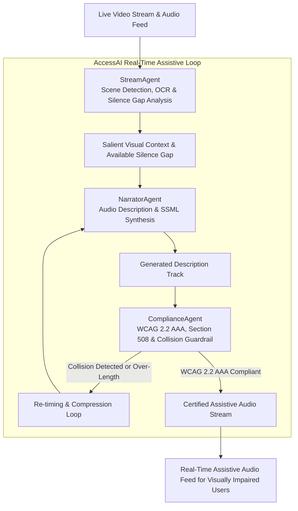

# AccessAI: Real-Time Audio Description & Accessibility Multi-Agent Specification

## 1. Executive Summary & Problem Formulation

Live media streams, keynote presentations, and video conferences remain largely inaccessible to visually impaired users due to a lack of synchronized, real-time audio descriptions. Traditional audio description workflows require manual post-production, making live broadcast accessibility prohibitive. Furthermore, naive automated approaches often collide with human dialogue or violate accessibility regulations (WCAG 2.2 AAA, Section 508, ADA Title III).

**AccessAI** delivers a **real-time accessibility multi-agent framework**:
1. **StreamAgent**: Ingests analysed frames carrying visual salience, on-screen text and the inter-dialogue silence gap, and normalises them for the pipeline.
2. **NarratorAgent**: Generates vivid, concise audio descriptions formatted as SSML speech streams fitted into dialogue pauses.
3. **ComplianceAgent**: Evaluates WCAG 2.2 (1.2.5, 1.2.7, 1.4.6), Section 508 and ADA Title III, reporting whether the description collides with dialogue and whether the pipeline met its latency budget.

---

## 2. Real-Time Assistive Multi-Agent Architecture

---

## 3. Compliance Guardrail Scorecard

Every criterion below is computed from the frame and the generated description. None is
asserted, and each has inputs that make it fail.

| Criterion | Target | Enforced Mechanism | Weight | On Violation |
| :--- | :--- | :--- | ---: | :--- |
| **WCAG 1.2.5 (AA)** | Audio Description present | Non-empty description track synthesized | 25 | Score reduced; audit fails |
| **WCAG 1.2.7 (AAA)** | Extended Audio Description | Engaged only when the gap is too short; requires `extended_pause_available` | 15 | Score reduced; audit fails |
| **WCAG 1.4.6 (AAA)** | Contrast ratio >= 7:1 normal text, >= 4.5:1 large text | Relative-luminance maths on the caption colours | 20 | Score reduced; audit fails |
| **Dialogue Collision** | Zero overlap with dialogue | Estimated speech duration vs. silence gap | 30 | Description pruned, then flagged |
| **E2E Latency Budget** | t <= 200ms | `perf_counter` around the pipeline, reported unmodified | 10 | Score reduced; audit fails |

Note on numbering: success criterion **1.4.3 Contrast (Minimum)** is Level **AA** and asks
for 4.5:1; **1.4.6 Contrast (Enhanced)** is Level **AAA** and asks for 7:1. The AAA target
this project claims is therefore 1.4.6. The response field is named
`wcag_rule_1_4_3_contrast_ratio` for backwards compatibility with the 1.0.0 API, but it
carries the measured ratio and is evaluated against the level in `conformance_level`.

### 3.1 Scoring

`compliance_score` is the summed weight of the criteria that passed, over the total
weight, as a percentage. `is_compliant` is true only when every criterion passes. The
weights are a policy choice, defined in `ComplianceGuardrails.CHECK_WEIGHTS`: a dialogue
collision carries the heaviest penalty because it does not merely fail to help, it masks
speech the listener could otherwise hear. Latency carries the lightest because a late but
correct description still conveys the scene.

---

### 3.2 Description degradation ladder

`NarratorAgent` returns the most detailed rung that fits the available gap:

| Level | Content |
| ---: | :--- |
| 0 | All salient entities, plus the on-screen text |
| 1 | Primary subject, plus the on-screen text |
| 2 | Primary subject alone |
| 3 | Primary subject hard-trimmed to the word budget the gap can carry |

Supporting entities are dropped before the on-screen text, and the on-screen text before
the primary subject. The primary subject is never dropped. When the gap is shorter than
the minimum utterance length no rung can fit, and the event reports
`fits_silence_gap: false` rather than claiming success.

---

## 4. Multi-Agent Topology & Responsibilities

| Agent Name | Core Specialty | Key Performance Metric |
| :--- | :--- | :--- |
| **`StreamAgent`** | Frame normalisation: entity trimming, salience ordering, gap budget. | Deterministic and non-mutating. |
| **`NarratorAgent`** | Audio description, degradation ladder, escaped SSML markup. | Fits the gap whenever the gap exceeds the minimum utterance length. |
| **`ComplianceAgent`** | WCAG 2.2, Section 508 and ADA Title III evaluation. | Five measured criteria; weighted score. |
