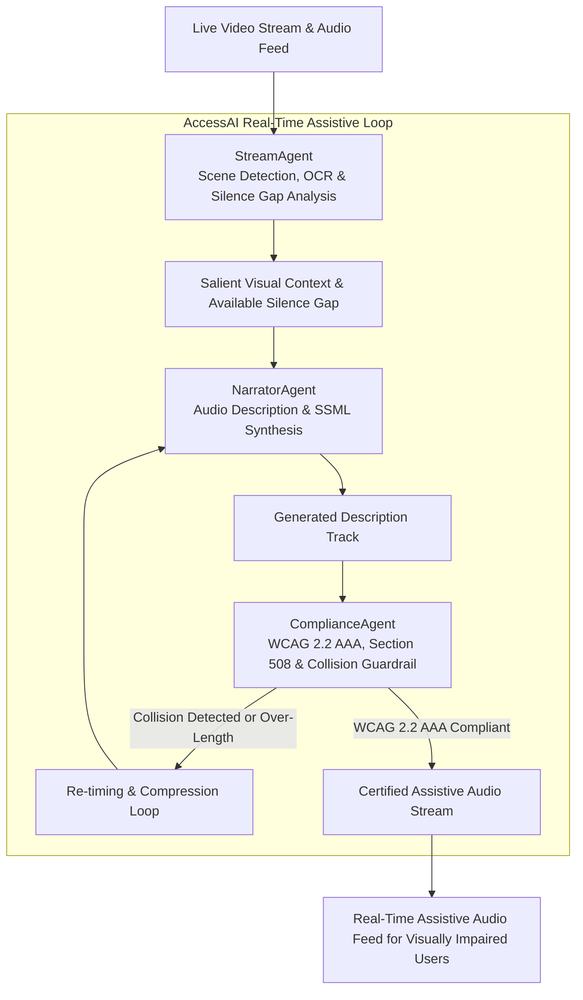

# AccessAI: Real-Time Audio Description & Accessibility Multi-Agent Specification

## 1. Executive Summary & Problem Formulation

Live media streams, keynote presentations, and video conferences remain largely inaccessible to visually impaired users due to a lack of synchronized, real-time audio descriptions. Traditional audio description workflows require manual post-production, making live broadcast accessibility prohibitive. Furthermore, naive automated approaches often collide with human dialogue or violate accessibility regulations (WCAG 2.2 AAA, Section 508, ADA Title III).

**AccessAI** delivers a **real-time accessibility multi-agent framework**:
1. **StreamAgent**: Ingests video frames, extracts visual salience, performs on-screen text OCR, and detects inter-dialogue silence gaps.
2. **NarratorAgent**: Generates vivid, concise audio descriptions formatted as SSML speech streams fitted into dialogue pauses.
3. **ComplianceAgent**: Enforces WCAG 2.2 AAA (Rules 1.2.5, 1.2.7), Section 508, and ADA Title III, guaranteeing zero human dialogue collision and sub-200ms latency.

---

## 2. Real-Time Assistive Multi-Agent Architecture

---

## 3. WCAG 2.2 AAA Compliance Guardrail Scorecard

| WCAG / Regulatory Rule | Target Standard | Enforced Mechanism | Action on Violation |
| :--- | :--- | :--- | :--- |
| **WCAG 1.2.5 (Level AA)** | Audio Description (Prerecorded) | Automated scene narration synthesis | Enforce synthesized track |
| **WCAG 1.2.7 (Level AAA)** | Extended Audio Description | Dynamic video pause / extended pause | Trigger extended window |
| **WCAG 1.4.3 / 1.4.6 (AAA)** | Contrast Ratio $\ge 7:1$ | High-contrast visual OCR validation | Flag visual drift |
| **Dialogue Collision** | Zero Overlap with Dialogue | Silence gap window constraint | Prune description length |
| **E2E Latency Budget** | $t_{\text{latency}} \le 200\text{ms}$ | Microsecond AST & SSML compilation | Shed low-priority tokens |

---

## 4. Multi-Agent Topology & Responsibilities

| Agent Name | Core Specialty | Key Performance Metric |
| :--- | :--- | :--- |
| **`StreamAgent`** | Visual entity extraction, OCR scanning, silence gap detection. | Feature extraction ($<35\text{ms}$). |
| **`NarratorAgent`** | Natural language audio description, SSML markup formatting. | Speech rate fit ($100\%$ within silence gap). |
| **`ComplianceAgent`** | WCAG 2.2 AAA, Section 508, and ADA Title III certification. | Zero dialogue collision guarantee. |
